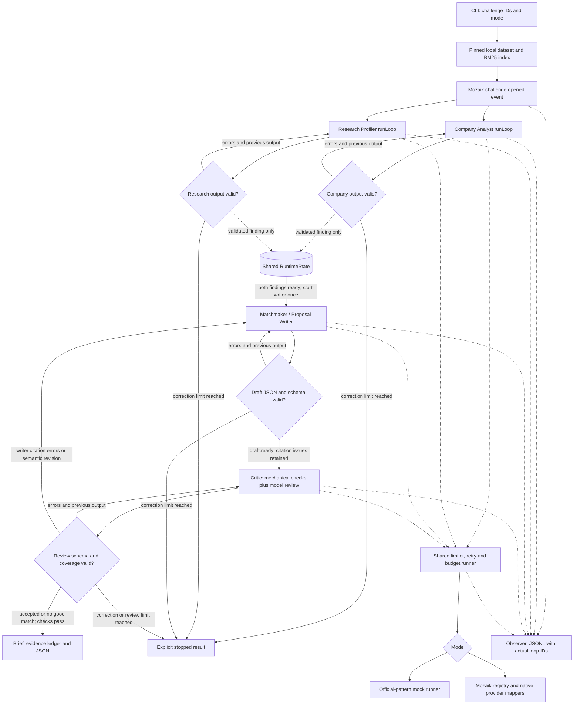

# Evidence to Pilot

A small EINSTEIN Science-to-Business Matchmaker for NTP Novi Sad coordinators, company engineering leads and researchers. Given company challenge IDs, four Mozaik agents search local evidence, propose a bounded collaboration pilot, and review every proposal before writing it to disk. The system proposes collaborations; it never scores or ranks people by worth.

**Current evidence: one failed live run, plus offline mock demonstrations.** A real Gemini run stopped on an unsupported Research Profiler quote before proposal writing or Critic review. The preserved [live result](runs/live-1/C001-CH1.json) is a failure, not a recommendation. Three fictional mock pairs, a full Critic correction trace and an abstention are included in [docs/demo](docs/demo/). The repair described below has not been rerun against a provider; no researcher consent, funding or deployment success is claimed.

## Run it

Use **Node 20 or later** (current local checks: macOS, Node 22.22.3, npm 10.9.8; earlier checks used Node 22.23.4). This meets the track's Node 18-or-later requirement; the bundled Gemini SDK requires Node 20. `@mozaik-ai/core` is pinned to **4.1.0**, with a committed npm lockfile.

On a fresh checkout only, install dependencies and download the fictional snapshot. This workspace already has both; reuse them here.

```bash
npm ci
npm run data:download             # network only for the fictional organizer snapshot
```

Normal offline verification and demonstration:

```bash
npm test                         # tiny authored fixtures, no data download or keys
npm run demo                      # no credentials; three proposals + one abstention
```

The download script fetches six source files at organizer commit `4fb99b3749adf0d10b5977089ff4c73f4f522240` into gitignored `data/`, with URLs, timestamps and SHA-256 hashes in a manifest. The loader verifies hashes. Raw organizer data is **not committed**. Initial installation/download require a connection; subsequent mock runs and tests do not.

Run your own challenge IDs after building:

```bash
npm run build
npm run run -- --mode mock --challenges C001-CH1,C025-CH1 --out out
npm run trace -- out/<run-id>/trace.jsonl
```

Each run has its own directory containing `trace.jsonl`, `summary.json`, and one Markdown brief, evidence ledger and JSON result per challenge. `accepted` means the configured checks passed, not that the parties agreed. `no_good_match` is a bounded-search abstention. `stopped` means invalid input/output, an exhausted policy/review limit or a failure; the CLI exits nonzero. Startup failures also get a JSONL record. Repeated challenge IDs are deduplicated.

### Live mode — original failure preserved; repair not live-tested

```bash
# Fresh checkout only: create .env from .env.example if it does not exist.
# Privately configure GEMINI_API_KEY and verify planning cost rates.
npm run build
npm run run -- --mode live --challenges C001-CH1,C025-CH1,C036-CH1
```

For an optional single-challenge smoke run, use `--challenges C001-CH1` instead. Live commands require authorization and are not part of offline verification.

| Environment variable | Gemini default | Anthropic alternative |
| --- | --- | --- |
| `PROVIDER` | `gemini` | `anthropic` |
| `MODEL` | `gemini-3.5-flash-lite` | `claude-haiku-4-5` |
| Credential, as named in Mozaik docs | `GEMINI_API_KEY` | `ANTHROPIC_API_KEY` |

For Anthropic, change both `PROVIDER` and `MODEL` in `.env` and supply `ANTHROPIC_API_KEY`. If `MODEL` is absent, the provider's default above is selected. Unknown models, provider/model mismatches and missing credentials fail before inference. `.env` is ignored; only `.env.example` is committed. The CLI remains in mock mode unless `--mode live` is explicit.

Live mode sends role-specific source packets: the Company Analyst receives company/challenge fields, the Research Profiler receives up to eight researcher/work candidates, and the writer and Critic receive the selected pair's evidence and company/challenge fields. It does not send the whole dataset. Review the provider's handling of data before replacing these fictional records with real ones. No emails, invitations or other external messages are sent.

The original run at `2026-10-30T09:36:38.995Z` used `gemini-3.5-flash-lite` on `C001-CH1`. Its two analysis calls overlapped, but it stopped with `Invalid agent output: Unsupported quote R1015.open_to`; there was no proposal or Critic review. See the preserved [trace](runs/live-1/trace.jsonl) and [summary](runs/live-1/summary.json). The trace does **not** contain the rejected raw response, so the offline regression reconstructs the observed error class; it is not a replay of the provider's exact answer. The old summary records $0.007857 before the other in-flight call settled; the two completed attempt rows total $0.015518 at configured planning rates. Neither amount is a verified bill.

### Request and spending controls

All agents share one runner with a concurrency semaphore and rolling 60-second request window. Defaults: `MAX_CONCURRENT=2`, `REQUESTS_PER_MINUTE=30`, `MAX_PROVIDER_CALLS=96`, `MAX_RETRIES=1`, `REQUEST_TIMEOUT_MS=90000`, `MAX_OUTPUT_TOKENS=4096`, `BUDGET_USD=2`. HTTP retries only cover 429 and 5xx, with bounded backoff; they consume both rate and call budgets. SDK-internal retries are disabled, verified with intercepted HTTP tests. Mock calls also exercise these admission controls but cost zero and never invoke a provider.

Producer validation repairs are separate from HTTP retries and Critic-requested writer revisions. Each role gets at most **two validation correction rounds per challenge**, shared across that role's invocations. These cover malformed JSON/schema, invalid analysis evidence and incomplete Critic review coverage. A schema-valid writer draft goes through the Critic: mechanical citation/structure errors and semantic concerns share a separate allowance of **two writer–Critic revision cycles**. For three challenges, an unrevised four-role path takes 12 logical calls, one Critic revision each takes 18, and two each take 24. Adding the maximum eight producer validation repairs per challenge gives 48 logical calls; one HTTP retry for each gives the 96-attempt ceiling. This is a capacity bound, not a guarantee that the deadline or cost budget permits all calls.

An offline packet-size estimate for `C001-CH1,C025-CH1,C036-CH1`, with two scripted Critic revisions each, reserved **$0.891778 for 24 tasks** under the default planning rates and full output caps. Even doubling those same reservations for one retry per task gives $1.783556, below the default $2 budget. Actual live drafts and correction messages can be longer; this is a mock-packet capacity estimate, not measured live usage or an invoice. See [VERIFICATION.md](VERIFICATION.md).

Cost reservations occur synchronously before awaiting a provider, so simultaneous agents cannot spend the same remaining budget. Input bytes provide a conservative planning-token proxy; output tokens are capped in each native request. Reported usage settles the estimate; an unsuccessful or unreported attempt retains its planning reservation. `INPUT_USD_PER_MILLION=1` and `OUTPUT_USD_PER_MILLION=5` are **planning assumptions, not verified provider prices**. Change them for the selected model/account. Estimates omit model-specific billing subtleties and cannot guarantee a provider invoice ceiling. The independent call limit always applies.

Timeouts stop waiting and reject new work when limits are exhausted. An in-flight SDK request cannot be cancelled through Mozaik's inference interface; its concurrency slot stays occupied until it settles. The SDK also receives a request timeout. A timeout or budget failure never becomes an accepted collaboration. The whole challenge has a deadline of eight request-timeout intervals. The $2 limit is enforced against configured planning-cost reservations and settlements, not against the provider's invoice.

Run summaries now wait for all logical task answers or timeout envelopes, including sibling analysis calls after a challenge stops. A transport still pending after timeout is reported as `inFlightProviderRequests`; its real final bill remains unknown. Empty or reasoning-only provider answers are treated as invalid output and sent back, rather than leaving Mozaik without an answer event.

## Architecture and actual concurrency



The standalone diagram is [docs/architecture.mmd](docs/architecture.mmd).

One `defineRuntime<SharedState>()` hosts four `createAgent` participants and an observer. Both the Company Analyst and Research Profiler subscribe to `challenge.opened`; each starts its own `runLoop` immediately. Neither waits for the other's answer. Every loop has a new `ModelContext`. `runLoop` returns void, so completion is observed through real `message_received.started` / `model.answer` events, not through `await runLoop(...)`.

The shared state contains the read-only dataset/index, the challenge's retrieved work/person ID pairs, validated company and research findings, drafts, validation counters, revisions, critic reviews and task/context mappings. On a model answer, the observer validates and writes that agent's finding, then emits `findings.ready`. Invalid findings stay out of shared findings and return to their producer with the exact errors and previous output. The writer's handler requires **both** validated findings and starts once, so arrival order cannot trigger duplicate drafts.

A schema-valid draft reaches the Critic even when its citations fail mechanical checks, preserving the draft → review → writer correction trace. Invalid Critic JSON, schema or review coverage returns to the Critic; the writer receives valid review feedback. Writer citation/structure repairs and semantic revisions share the two-cycle review allowance; malformed writer JSON/schema uses the writer's producer-validation allowance. Every allowance is bounded, and exhaustion yields `stopped`. Different challenges run one at a time to bound spending; the two analysis agents overlap within each challenge. Loops can overlap under a concurrency limit of one, but simultaneous provider execution requires a limit of at least two.

This is an event-driven workflow with a parallel analysis branch and a bounded review cycle, not an autonomous open-ended swarm. The [API verification note](docs/mozaik-api-check.md) documents the installed declarations checked before implementation and the official mock-runner pattern used.

## Evidence and the Critic

The local index uses BM25 (`k1=1.5`, `b=0.75`), Serbian Cyrillic-to-Latin transliteration, diacritic normalization and a small explicit stopword list. No paid embeddings or remote retrieval. It searches profile/work text, then returns up to eight distinct researcher IDs backed by **work-side** author/participant/inventor IDs. Profile documents contribute to corpus statistics but are not accepted as work evidence. Names never form join keys; retrieval orders source documents for one query, not people's worth or capability.

Facts are typed citations: `{recordId, field, quote}`. They must be exact contiguous excerpts of the specified field (string arrays are deterministically joined with `; `). The `field` must be the canonical local key, such as `open_to`, never `R1015.open_to`. A narrow normalization handles a model mistakenly putting that field reference in the **quote value**, for example:

```json
{"recordId":"R1015","field":"open_to","quote":"R1015.open_to"}
```

With the same record and field, `"quote":"open_to"` is also recognized. If the referenced source field exists and is nonempty, its exact source text replaces the mistaken reference. The original and resolved citation are logged in a `citation_resolved` event; downstream checks and ledgers use the resolved text. A different record's prefix or an arbitrary path is not interpreted as a reference. Invented quotations still fail exact-text validation; there is no fuzzy quotation matching.

Mechanical checks require known IDs, exact source text, challenge/capacity/profile/substantive work evidence, a valid work-side link, a retrieved pair, and consistency with shared findings. The model Critic also receives full selected source fields and must review every fact, rationale and plan field for entailment, negative constraints, attribution, topic fit and feasibility. The application checks its claimed review coverage and cannot be overruled on a mechanical failure. “Proposed” prose is reviewed for hidden assertions too.

Unsupported claims return to the writer, with reasons logged. A model can still make a poor semantic judgement; mechanical exactness does not prove context-sensitive entailment. Plans, targets, resource requests and IP terms are labelled as proposals. All availability, current affiliation, personal contribution, permissions and consent need human confirmation. A source's missing biography or abstract is never filled in with imagined experience. Job ads, old plans and coauthorship do not establish present resources or individual skills. Company pages are downloaded for later use but deliberately not used as current capability evidence in this version.

## Included mock output and full trace

The [mock demo](docs/demo/README.md) contains these outcomes from an actual local run:

| Challenge | Pair in fictional data | Mock outcome | Pilot topic |
| --- | --- | --- | --- |
| [C001-CH1](docs/demo/C001-CH1.md) | C001 / R1008 | accepted after revision | Unsupervised ICS alert calibration |
| [C025-CH1](docs/demo/C025-CH1.md) | C025 / R0637 | accepted after revision | PCB emission hotspot review |
| [C036-CH1](docs/demo/C036-CH1.md) | C036 / R0976 | accepted after revision | Berry packaging feasibility trial |
| [C101-CH1](docs/demo/C101-CH1.md) | none proposed | no good match | Mock domain coverage abstention |

These are scripted, domain-specific mock outputs selected from the lexical shortlist, **not live model recommendations**. The mock recognizes three technical domains (ICS anomalies, PCB emissions, berry packaging) and uses conditional pilot templates. Everything else abstains. The mock Critic checks the same source rules and review contract but cannot provide an LLM's semantic reasoning.

`npm run demo` includes `--inject-unsupported`. The first draft for each matched pair deliberately inserts a false guarantee in a researcher biography citation. The Critic records an `Unsupported quote` error, requests revision, and accepts only after that quote is removed. Injection is forbidden in live mode. This is a labelled test fault, not a naturally observed model hallucination.

[trace.jsonl](docs/demo/trace.jsonl) contains the whole run, including retrieval, shared-state writes, drafts, corrections, outcomes and provider-attempt records. [trace-report.md](docs/demo/trace-report.md) prints a per-task table and measured loop intersections. Start/end records contain run ID, task ID, agent, actual Mozaik loop ID, model, timestamps, usage and estimated cost. Unknown usage stays `null`; mock cost is zero. Task totals aggregate all attempts and remain unknown if any attempt lacks usage; attempt rows retain the detailed cost ledger. No chain-of-thought or credentials are collected.

```bash
npm run trace -- docs/demo/trace.jsonl
```

## Plugging into the EINSTEIN network and EINSTEIN Stars

**Proposed workflow; no existing connector or official API is assumed.** Evidence to Pilot would sit between challenge intake and a coordinator's decision to approach possible partners. The CLI and proposal files exist; the adapters and review queue below remain to be built and agreed with network staff.

| Step | Owner | Concrete input and output |
| --- | --- | --- |
| Authorize intake | Human coordinator and record owners | Approve the challenge and opted-in researcher/work records, including what may reach the model provider. An adapter would retain stable IDs, source fields, verification dates and correction/withdrawal status. |
| Prepare candidates | AI | Run the local batch on that authorized snapshot. Produce a pilot brief, JSON and evidence ledger, or explicit abstention/failure. Retain run and source IDs for review. |
| Check and introduce | Human coordinator and both parties | Review the cited evidence; confirm current expertise, resources, interest and consent. Only then share a meeting packet and arrange a scoping discussion. `accepted` by the CLI does not authorize an introduction. |
| Record the decision | Human coordinator, with AI drafting support | Record agreed scope, owners, data access, IP questions and a go/no-go experiment. Feed factual corrections or withdrawals into the next authorized snapshot. |

For **EINSTEIN Stars**, a coordinator could adapt a mutually approved pilot into a discussion packet for program staff, a potential industrial mentor and a potential academic supervisor. For example, the fictional ICS mock brief could supply a research question about alert calibration, a bounded baseline experiment, proposed deliverables and explicit questions about data access and supervision. The packet would also need participant interest, learning/research objectives, expected contributions, milestones and open IP questions. Program staff would decide whether mentoring, an industrial PhD discussion or another route is appropriate and verify current eligibility and procedures. These routes are hypothetical uses, not statements of current program offerings; the tool does not select participants or infer supervisor availability, funding entitlement or program acceptance.

A first evaluation would measure time to a mutually agreed scoping meeting, evidence corrections, consent withdrawals and pilots reaching an agreed decision gate. Those are collaboration-process outcomes, not researcher-value scores. The intended context is the [EINSTEIN track](https://jigjoy.ai/tracks/einstein) and the [EINSTEIN project's knowledge-transfer work](https://einsteineuproject.com/2024/01/30/let-the-journey-begin-a-glimpse-into-the-einstein-project-kick-off-meeting/); no current call or official integration is claimed.

## Responsible use and limitations

- Only fictional organizer records are used. No real-person enrichment, personal contact harvesting or automatic outreach. Do not remove the synthetic-data labels when sharing examples.
- Raw data and normal run output are ignored by Git. The committed demo contains only selected evidence excerpts and derived proposals/traces needed for review, not the dataset.
- Mozaik Cloud export is forcibly disabled, including cached credential discovery, because its visitor can send entire loop payloads. Its “telemetry disabled” warning is expected. Live inference still sends the stated limited packet to the chosen model provider.
- Original Unicode names/text are preserved. Retrieval transliterates but does not translate Serbian or resolve morphology; lexical mismatches and missing fields can hide good collaborations. Alias profiles are not merged. Numeric lexical scores are not exported as ratings.
- The top-eight shortlist is a recall limitation. Abstention means insufficient evidence within that search and mode, not that UNS lacks expertise. No accuracy or broad recall metric has been established on all 489 challenges.
- One real-provider run failed before writer/Critic review; its trace is preserved. The repair is tested offline, with no successful live proposal or post-repair live run claimed. Semantic quality and actual billing remain unverified. A live Critic can agree with an incorrect writer.
- Local traces contain selected fictional source text. Before real deployment, add access controls, retention/deletion handling and consent-aware exports; human approval is required before any introduction or external sharing.
- No web service, database, resume protocol, funding scout, automatic translations or contact sender is included. Review limits can end in `stopped` rather than inventing a match.

## Scope of work

The code in this repository was written during the NTP Novi Sad AI Hackathon on 30 October 2026, after the Friday 10:00 CET kickoff. `docs/prep/` contains research notes and test material prepared before the event and was left unchanged. Existing Mozaik examples and libraries were used as permitted boilerplate/reference; this entry's implementation, tests, proposal templates and generated demo were created during the event.

See [NEXT_STEPS.md](NEXT_STEPS.md) for the handoff and next three improvements, and [VERIFICATION.md](VERIFICATION.md) for executed commands and results.
