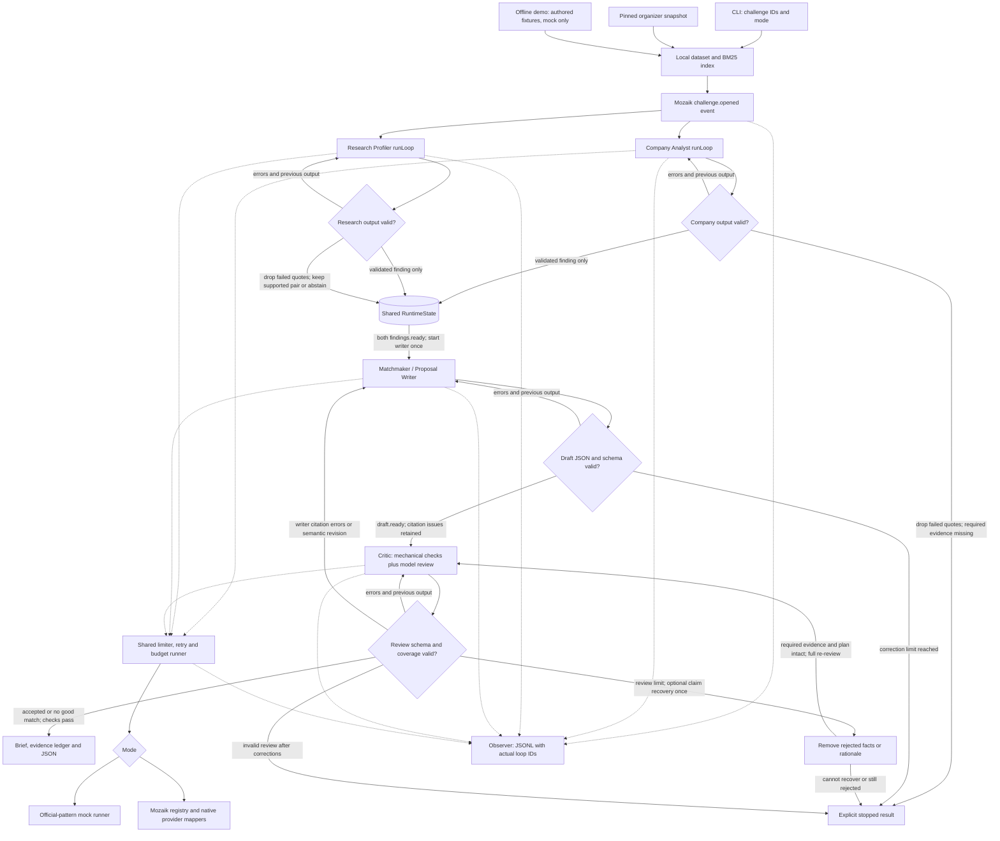

# Evidence to Pilot

Evidence to Pilot helps EINSTEIN coordinators turn a company's technical challenge into a concrete research collaboration worth discussing. Two Mozaik agents investigate company needs and researcher evidence concurrently; a Writer proposes a three-month pilot, and a Critic sends unsupported claims or weak experiment plans back for revision. Each brief names a specific pair, a testable mechanism, a baseline, decision criteria, requested resources and a first meeting agenda, with record-level citations. It proposes collaborations and **never scores or ranks people by worth**.

## Real live result: three challenges, three accepted proposals

[**live-8**](runs/live-8/summary.json) accepted **3 of 3 challenges** on 30 October 2026 using Anthropic `claude-haiku-4-5` for both analysts and `claude-sonnet-5-5` for Writer and Critic. The recorded batch took about **316 seconds** (315.099 seconds between trace start and finish), with **22 provider attempts**, peak concurrent inference **2**, and **$1.181064 estimated accounted cost**. This is a real provider run on fictional organizer data, not a mock. Cost uses shared planning rates of $3 input / $15 output per million tokens; it is not a verified bill. These artifacts were supplied from the completed run; M5 inspected them without making new provider calls.

| Accepted pair | Concrete pilot | Evidence ledger | Structured result |
| --- | --- | --- | --- |
| [C001 / R1008: ArmaturaSec × Krisztina Kiss](runs/live-8/C001-CH1.md) | Site-specific industrial-network anomaly detection with a comparator fallback | [C001-CH1 sources](runs/live-8/C001-CH1.evidence.md) | [Proposal and reviews](runs/live-8/C001-CH1.json) |
| [C025 / R0637: Nexara Embedded × Dijana Radulović](runs/live-8/C025-CH1.md) | PCB emission-risk checks against five boards and pre-compliance scans | [C025-CH1 sources](runs/live-8/C025-CH1.evidence.md) | [Proposal and reviews](runs/live-8/C025-CH1.json) |
| [C036 / R0976: FreshPak × Jelena Marković](runs/live-8/C036-CH1.md) | Raspberry film-permeability and headspace trial with a current-film baseline | [C036-CH1 sources](runs/live-8/C036-CH1.evidence.md) | [Proposal and reviews](runs/live-8/C036-CH1.json) |

**Inspect the full run:** [raw JSONL trace](runs/live-8/trace.jsonl) · [per-task report, overlap and send-backs](docs/live-8-trace-report.md). `accepted` means the recorded mechanical and model checks passed; it does not establish consent, partner agreement or real-world feasibility. Eight development runs are preserved, including failures; they are not a controlled accuracy benchmark.

### How the agents run at the same time and what they share

For each challenge, both analysts subscribe to the same `challenge.opened` event and start separate Mozaik `runLoop` calls without waiting for each other. They share one `RuntimeState`: the local dataset/index, retrieved work/researcher ID pairs, validated findings, drafts, correction counters and Critic reviews. The observer publishes each validated finding and emits `findings.ready`. The Writer starts once **both** findings exist. The Critic then reviews the draft and sends specific corrections back to its producer. Challenges run one at a time; analysis within each challenge is concurrent.

The trace script measures these intersections between the initial Company Analyst and Research Profiler loops in live-8:

| Challenge | Overlap between analysis loops |
| --- | ---: |
| C001-CH1 | 5,901 ms |
| C025-CH1 | 6,729 ms |
| C036-CH1 | 6,640 ms |

These are wall-clock loop intersections, not a claim of an equivalent speed-up. Live-8 also records two simultaneous inference requests.

### Where the real Critic stepped in

Every live-8 proposal was revised once before acceptance. These were actual model findings, with no injected faults:

| Challenge | Revision 0 send-back | Change visible in the accepted brief |
| --- | --- | --- |
| C001-CH1 | An assumed data lead, an unverified comparator and vague hardware limits | Ask the company to nominate an access owner; add a control-chart fallback; agree latency, memory and CPU limits |
| C025-CH1 | Ambiguous false-positive criteria; assumed tool licences and netlist availability | Add numeric gates and a scan-mapping pre-check; verify licences and narrow the scope if inputs are unavailable |
| C036-CH1 | Describing prior informal trials as untested; uncited details; unclear go/no-go | Correct the rationale, add supporting facts and propose sample counts, headspace error and mould-reduction thresholds |

The same trace records **four additional producer-validation send-backs**: one unsupported Profiler quote, two invalid Writer JSON answers and one overlong Critic issue. Corrections remain visible in the [report](docs/live-8-trace-report.md), rather than being hidden behind the final accepted status.

## Reproduce it

Use **Node 20 or later** (within the track's Node 18-or-later requirement; the installed Gemini SDK requires Node 20). `@mozaik-ai/core` is pinned to **4.1.0** in both package files.

### No-credential mock demo: fresh clone, two commands

```bash
npm ci
npm run demo
```

Installation needs package-registry access. After installation, the demo is entirely offline: it builds TypeScript, uses tiny **authored fictional fixtures** included in the code, and calls no provider. It does not need `.env` or `data/`. The official custom-inference-runner pattern drives the real Mozaik runtime, shared state, validators and review loop. Expected **mock** output:

```text
C901-CH1  accepted       R9001
C902-CH1  accepted       R9002
C903-CH1  accepted       R9003
C999-CH1  no_good_match
Peak concurrent inference: 2
```

The first draft for each matched pair deliberately contains an unsupported quotation; the scripted Critic requests correction before acceptance. This tests the repair path, not live semantic quality. Each new `out/<run-id>/` contains briefs, evidence ledgers, structured results, `summary.json`, `trace.jsonl` and `sources.json` with the authored demo records. The source links point to that local file. Normal run output is gitignored.

```bash
npm run trace -- out/<run-id>/trace.jsonl
npm test
```

The older [organizer-snapshot mock examples](docs/demo/README.md) use different IDs and are clearly labelled mock. They are separate from the three real live proposals above.

### Live reproduction with credentials

Download the fictional organizer snapshot once, then build:

```bash
npm run data:download
npm run build
```

The existing downloader retrieves six files from commit `4fb99b3749adf0d10b5977089ff4c73f4f522240` into gitignored `data/`. A manifest records URLs, download time and SHA-256 hashes; the loader checks the snapshot and loaded-file hashes. Raw organizer data is not committed.

Create a private `.env` from [.env.example](.env.example) if one does not already exist. Supply `ANTHROPIC_API_KEY` privately, and review planning rates and spending limits before live inference. Leave `MODEL` and the role overrides blank to use the recommended mixed configuration:

```bash
npm run run -- --mode live --challenges C001-CH1,C025-CH1,C036-CH1 --out out
npm run trace -- out/<run-id>/trace.jsonl
```

| Setting | Recommended default | Gemini alternative |
| --- | --- | --- |
| `PROVIDER` | `anthropic` | `gemini` |
| Company Analyst / `COMPANY_MODEL` | `claude-haiku-4-5` | `gemini-3.5-flash` |
| Research Profiler / `RESEARCH_MODEL` | `claude-haiku-4-5` | `gemini-3.5-flash` |
| Writer / `WRITER_MODEL` | `claude-sonnet-5-5` | `gemini-3.5-flash` |
| Critic / `CRITIC_MODEL` | `claude-sonnet-5-5` | `gemini-3.5-flash` |
| Credential named by Mozaik | `ANTHROPIC_API_KEY` | `GEMINI_API_KEY` |

Precedence is **nonempty role override → nonempty `MODEL` → provider/role default**. All roles use one provider. For Gemini, set `PROVIDER=gemini`, supply `GEMINI_API_KEY`, and clear any Anthropic model overrides. Unknown models, provider/model mismatches and missing credentials fail before inference. Existing `.env` values remain overrides; upgrading the code does not replace them. The CLI defaults to mock unless `--mode live` is explicit.

To run the organizer snapshot without provider calls, use:

```bash
npm run run -- --mode mock --challenges C001-CH1,C025-CH1,C036-CH1,C101-CH1 --inject-unsupported
```

The normal CLI requires `data/` (or `--data <directory>`); it never silently substitutes demo fixtures. `--inject-unsupported` is forbidden in live mode. Live responses are nondeterministic, so reproduction may produce different pairs, revisions or stopped results.

## Architecture



[Standalone Mermaid diagram](docs/architecture.mmd) · [checked Mozaik APIs and mock-runner reference](docs/mozaik-api-check.md).

One `defineRuntime<SharedState>()` hosts four `createAgent` participants and an observer. Each task has a separate `ModelContext`. Because `runLoop` returns void, the observer uses real `message_received.started` and `model.answer` events to track completion and actual loop IDs. The parallel analysis branch and bounded review cycle are event-driven; this is not an open-ended autonomous swarm.

Invalid findings return to their producer before entering shared state. A schema-valid draft reaches the Critic even if its citations fail mechanical checks. Incomplete Critic coverage returns to the Critic; valid correction feedback goes to the Writer. Each role has at most two producer-validation corrections per challenge, and each proposal has at most two Writer–Critic revisions. At the limit, bounded claim removal can discard unsupported optional evidence or replace rejected rationale with a tentative question; required evidence and plan fields must survive, and a reduced draft needs a fresh full review. Persistent failure yields `stopped`.

## Evidence and acceptance

The local BM25 lexical index uses Serbian script transliteration, diacritic normalization and an explicit stopword list, without paid embeddings. It retrieves up to eight distinct researcher candidates backed by work-side author/participant/inventor IDs. Names are never join keys. Query relevance orders documents for one challenge, not people's value or capability.

Facts use `{recordId, field, quote}`. Mechanical checks require existing IDs, valid work-side links, the retrieved pair, required challenge/capacity/profile/work evidence and consistency with shared findings. Quotations must be contiguous substrings of their fields after NFKC, whitespace, quote-mark, case and Serbian script normalization. Array fields are joined with `; `; punctuation, order and diacritics remain significant. Nonadjacent stitching, paraphrase and translation cannot pass as quotations. A narrow repair resolves a quote that mistakenly repeats its own field reference into exact field text, logs `citation_resolved`, then validates it normally; it cannot rescue arbitrary invented text.

The model Critic reviews every fact, rationale and plan field, including negative context, attribution, feasibility and hidden factual premises inside proposals. Missing, duplicate or unknown claim-verdict paths fail mechanical validation. A model cannot override mechanical failures. Reasoning and plans are explicitly labelled proposals: requested resources and thresholds are not established availability or achieved outcomes. Exact quoting alone does not prove entailment, and a live Critic can still agree with a mistaken Writer.

Outputs distinguish `accepted` (configured checks passed), `no_good_match` (insufficient evidence in this bounded search) and `stopped` (invalid output, failure or exhausted limits). Stopped challenges produce a nonzero CLI exit. A no-match does not imply absent expertise across the university or network. Startup failures also write a trace record.

## Request and spending controls

All agents share a concurrency semaphore, a rolling 60-second request window and one budget ledger. The defaults match live-8's recorded policy:

| Control | Default |
| --- | ---: |
| Concurrent requests / requests per minute | 2 / 30 |
| Maximum provider attempts / HTTP retries per task | 96 / 1 |
| Request timeout / output token cap | 90,000 ms / 4,096 |
| Aggregate retry-backoff allowance | 120,000 ms |
| Planning-cost budget | $2 |
| Planning rates per million input / output tokens | $3 / $15 |

All controls are configurable in [.env.example](.env.example). Retries cover 429 and 5xx, honor usable `Retry-After`, and use bounded exponential backoff with jitter. SDK-internal retries are disabled. Each attempt consumes rate/call budgets; output validation repairs and Critic revisions have separate bounded counters. The 96-attempt ceiling may stop the theoretical 102-attempt worst case for three challenges.

Reservations are made before a provider call and settled against reported usage. Failed or unreported attempts retain their planning reservation. Rates are shared across roles and **are assumptions, not verified current provider prices**; set them to cover every selected model. The budget constrains accounting estimates, not a guaranteed invoice ceiling. In-flight requests can outlive application timeouts; summaries report unsettled transport requests. The whole challenge has a deadline of eight request-timeout intervals.

JSONL records expose run/task/agent/loop IDs, model, timestamps, usage, estimated cost, corrections and sanitized provider errors. Unknown usage stays unknown; mock cost is zero. `npm run trace` prints task totals and wall-clock loop intersections. No chain-of-thought or credentials are collected.

## Plugging into the EINSTEIN network and EINSTEIN Stars

**Proposed integration, not an existing connector.** The implemented boundary is a local snapshot in and reviewable proposal/evidence/trace files out. No official API, deployed connection or program eligibility is assumed.

| Stage | Owner | What the integration would do |
| --- | --- | --- |
| Challenge intake | Human coordinator and record owners | Authorize company challenges and opted-in researcher/work records, including provider disclosure. A future adapter retains stable IDs, verification dates and correction/withdrawal status. |
| Prepare a meeting packet | AI | Produce a three-month pilot, evidence ledger and review history, or an explicit no-match/failure, from that authorized snapshot. |
| Verify and introduce | Human coordinator and both parties | Confirm source context, current resources, contribution, interest and consent. Approve sharing and contact before any introduction. CLI acceptance never authorizes outreach. |
| Decide and learn | Humans, with AI drafting support | Agree owners, access, IP questions and a go/no-go experiment; feed factual corrections and withdrawals into the next authorized snapshot. |

For **EINSTEIN Stars**, a mutually approved pilot could become a discussion packet for program staff, a potential industrial mentor and an academic supervisor. The live ICS brief already supplies a technical mechanism, baseline experiment and a conditional follow-on research question. An adapter would add participant-approved learning objectives, expected contributions, milestones and open supervision/IP questions. Staff would determine whether mentoring, an industrial PhD discussion or another route is appropriate under the program's actual procedures. These are proposed uses, not claims of current offerings, funding, eligibility or admission. The system does not select or rank Stars participants.

The next useful evaluation is time to a mutually agreed scoping meeting, evidence corrections and pilots reaching an agreed decision gate—not researcher-value scores. The intended context is the [EINSTEIN Science-to-Business Matchmaker track](https://jigjoy.ai/tracks/einstein); adapters, a consent-aware review queue and operational evaluation remain future work.

## Responsible data and limitations

- All organizer records and authored demo fixtures are fictional. No real-person enrichment, contact harvesting or automatic outreach is implemented. Keep the synthetic-data labels on shared examples.
- The system never scores or ranks people by worth. Retrieval relevance is challenge-specific and document-based; coauthorship does not establish individual mastery. Human approval and both parties' consent must precede contact or sharing.
- Raw organizer data, credentials and ordinary output are gitignored. Preserved run artifacts contain selected fictional excerpts and derived outputs for judging, not the full dataset.
- Live inference sends role-specific packets to the selected provider: company/challenge fields, up to eight research/work candidates, or selected-pair evidence. It does not send the whole dataset. Mozaik Cloud export and cached credential discovery are disabled; the telemetry-disabled warning is expected.
- Serbian Latin/Cyrillic variation, missing fields, stale profiles and name collisions can reduce retrieval quality. Alias profiles are not merged. Company pages are downloaded but not used as proof of current capability. See the pre-event [data profile](docs/prep/data_profile.md).
- Three accepted challenges do not establish general accuracy, recall, domain feasibility or provider superiority. The mock covers three scripted technical domains; its semantic judgements are not a substitute for model or human review. Availability, facilities, permissions, funding and personal contributions remain unconfirmed.
- Real deployment would require consent-aware intake, access controls, retention/deletion and correction handling. No web service, database, resume protocol or contact sender is included.

## Lessons from live runs

All eight runs are preserved on the same fictional snapshot. Across **22 challenge attempts**, four were accepted (one in live-4 and three in live-8) and eighteen stopped. Repeated challenges, changing code and differing settings prevent treating this as a benchmark or a controlled model comparison.

| Run and model configuration | Recorded outcome | Lesson supported by the record |
| --- | --- | --- |
| [live-1](runs/live-1/summary.json), Gemini Flash Lite | 0/1 accepted; unsupported `R1015.open_to` quote | Citation extraction can fail before drafting. Raw response is absent, so its regression reconstructs the error class. |
| [live-2](runs/live-2/summary.json), Gemini Flash Lite | 0/3; incomplete Critic coverage and HTTP 429 | Validate coverage explicitly and bound repairs and provider retries. |
| [live-3](runs/live-3/summary.json), all Haiku | 0/3; HTTP 400 | Provider schema compatibility needs checking. Missing error bodies prevent proving the original cause. |
| [live-4](runs/live-4/summary.json), Gemini Flash | 1/3; C001 accepted with R1015, others stopped on 503/429 | A successful proposal does not make the batch successful. |
| [live-5](runs/live-5/summary.json), Gemini Flash | 0/3; HTTP 429 on all 12 attempts | Rate/quota failures remain distinct from match quality; status alone does not prove daily quota exhaustion. |
| [live-6](runs/live-6/summary.json), all Haiku | 0/3; stitched/skipped Profiler quotes and review exhaustion | Copy shorter contiguous spans; retain strict evidence checks. Word limits and feasible decision criteria also matter. |
| [live-7](runs/live-7/summary.json), all Haiku | 0/3; review limits for C001/C036 and an overlong Critic issue for C025 | Even repaired quotes do not guarantee convergence: concise reviews and concrete, conditional pilot plans are necessary. |
| [live-8](runs/live-8/summary.json), Haiku analysts + Sonnet Writer/Critic | 3/3, each after one Critic revision; four other validation repairs | This mixed configuration completed the selected batch while keeping visible corrections. One batch does not prove model superiority. |

For each row, the sibling `trace.jsonl` and challenge JSON files preserve the actual errors and reviews. Later code includes provider-compatible structured output, bounded producer repairs, short-copy guidance and explicit proposal labels; the traces do not isolate each change's causal effect. The old live-1 summary also predates settlement of its sibling call, so its accounted total is incomplete. No new live run was performed for M5.

## Scope of work

The code in this repository was written during the NTP Novi Sad AI Hackathon on 30 October 2026, after the Friday 10:00 CET kickoff. `docs/prep/` contains research notes and test material prepared before the event and was left unchanged. Existing Mozaik examples and libraries were used as permitted boilerplate/reference; the implementation, tests, proposal templates and generated demonstrations were created during the event.

[NEXT_STEPS.md](NEXT_STEPS.md) records what works, what is mocked and the next three improvements. [VERIFICATION.md](VERIFICATION.md) records commands and verification limits. Preserved live artifacts are evidence from completed runs, not a claim that M5 executed them again.
