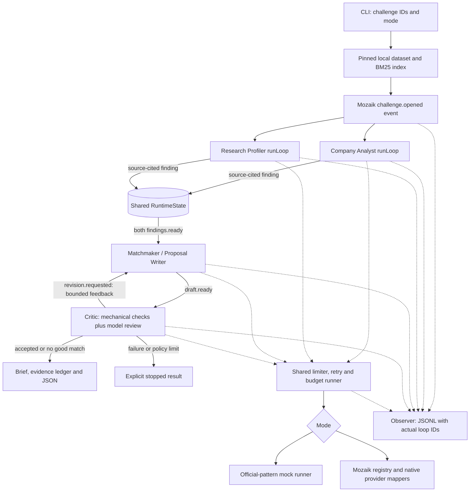

# Evidence to Pilot

A small EINSTEIN Science-to-Business Matchmaker for NTP Novi Sad coordinators, company engineering leads and researchers. Given company challenge IDs, four Mozaik agents search local evidence, propose a bounded collaboration pilot, and review every proposal before writing it to disk. The system proposes collaborations; it never scores or ranks people by worth.

**Current evidence: mock runs only.** Three different fictional pairs, a full critic correction trace and an abstention are included in [docs/demo](docs/demo/). No live-provider results, researcher consent, secured funding or deployment success are claimed.

## Run it

Use **Node 20 or later** (tested on Node 22.23.4). This meets the track's Node 18-or-later requirement; the bundled Gemini SDK requires Node 20. `@mozaik-ai/core` is pinned to **4.1.0**, with a committed npm lockfile.

```bash
npm ci
npm test                         # offline; tiny authored fixtures, no data download or keys
npm run data:download             # network only for the fictional organizer snapshot
npm run demo                      # no credentials; three proposals + one abstention
```

The download script fetches six source files at organizer commit `4fb99b3749adf0d10b5977089ff4c73f4f522240` into gitignored `data/`, with URLs, timestamps and SHA-256 hashes in a manifest. The loader verifies hashes. Raw organizer data is **not committed**. Initial installation/download require a connection; subsequent mock runs and tests do not.

Run your own challenge IDs after building:

```bash
npm run build
npm run run -- --mode mock --challenges C001-CH1,C025-CH1 --out out
npm run trace -- out/<run-id>/trace.jsonl
```

Each run has its own directory containing `trace.jsonl`, `summary.json`, and one Markdown brief, evidence ledger and JSON result per challenge. `accepted` means the configured checks passed, not that the parties agreed. `no_good_match` is a bounded-search abstention. `stopped` means invalid input/output, an exhausted policy/review limit or a failure; the CLI exits nonzero. Startup failures also get a JSONL record. Repeated challenge IDs are deduplicated.

### Live mode — not yet run against a real provider

```bash
cp .env.example .env
# Edit .env privately: add GEMINI_API_KEY; verify planning cost rates.
npm run build
npm run run -- --mode live --challenges C001-CH1
```

| Environment variable | Gemini default | Anthropic alternative |
| --- | --- | --- |
| `PROVIDER` | `gemini` | `anthropic` |
| `MODEL` | `gemini-3.5-flash-lite` | `claude-haiku-4-5` |
| Credential, as named in Mozaik docs | `GEMINI_API_KEY` | `ANTHROPIC_API_KEY` |

For Anthropic, change both `PROVIDER` and `MODEL` in `.env` and supply `ANTHROPIC_API_KEY`. If `MODEL` is absent, the provider's default above is selected. Unknown models, provider/model mismatches and missing credentials fail before inference. `.env` is ignored; only `.env.example` is committed. The CLI remains in mock mode unless `--mode live` is explicit.

Live mode sends the selected challenge, limited company fields and up to eight researcher/work candidates to the configured provider. It does not send the whole dataset. Review the provider's handling of data before replacing these fictional records with real ones. No emails, invitations or other external messages are sent.

### Request and spending controls

All agents share one runner with a concurrency semaphore and rolling 60-second request window. Defaults: `MAX_CONCURRENT=2`, `REQUESTS_PER_MINUTE=30`, `MAX_PROVIDER_CALLS=32`, `MAX_RETRIES=1`, `REQUEST_TIMEOUT_MS=90000`, `MAX_OUTPUT_TOKENS=4096`, `BUDGET_USD=2`. Retries only cover 429 and 5xx, with bounded backoff; they consume both rate and call budgets. SDK-internal retries are disabled, verified with intercepted HTTP tests. Mock calls also exercise these admission controls but cost zero and never invoke a provider.

Cost reservations occur synchronously before awaiting a provider, so simultaneous agents cannot spend the same remaining budget. Input bytes provide a conservative planning-token proxy; output tokens are capped in each native request. Reported usage settles the estimate; an unsuccessful or unreported attempt retains its planning reservation. `INPUT_USD_PER_MILLION=1` and `OUTPUT_USD_PER_MILLION=5` are **planning assumptions, not verified provider prices**. Change them for the selected model/account. Estimates omit model-specific billing subtleties and cannot guarantee a provider invoice ceiling. The independent call limit always applies.

Timeouts stop waiting and reject new work when limits are exhausted. An in-flight SDK request cannot be cancelled through Mozaik's inference interface; its concurrency slot stays occupied until it settles. The SDK also receives a request timeout. A timeout or budget failure never becomes an accepted collaboration. The whole challenge has a deadline of eight request-timeout intervals and at most two writer revisions.

## Architecture and actual concurrency



The standalone diagram is [docs/architecture.mmd](docs/architecture.mmd).

One `defineRuntime<SharedState>()` hosts four `createAgent` participants and an observer. Both the Company Analyst and Research Profiler subscribe to `challenge.opened`; each starts its own `runLoop` immediately. Neither waits for the other's answer. Every loop has a new `ModelContext`. `runLoop` returns void, so completion is observed through real `message_received.started` / `model.answer` events, not through `await runLoop(...)`.

The shared state contains the read-only dataset/index, the challenge's retrieved work/person ID pairs, validated company and research findings, drafts, revisions, critic reviews and task/context mappings. On a model answer, the observer validates and writes that agent's finding, then emits `findings.ready`. The writer's own situation handler checks that **both** findings exist before it starts. Its draft triggers the Critic's handler. A revision event carries shared feedback back to the writer; acceptance or abstention ends the challenge. Different challenges run one at a time to bound spending; the two analysis agents really overlap within each challenge. Agents also overlap under a concurrency limit of one, but actual simultaneous provider execution requires a limit of at least two.

This is an event-driven workflow with a parallel analysis branch and a bounded review cycle, not an autonomous open-ended swarm. The [API verification note](docs/mozaik-api-check.md) documents the installed declarations checked before implementation and the official mock-runner pattern used.

## Evidence and the Critic

The local index uses BM25 (`k1=1.5`, `b=0.75`), Serbian Cyrillic-to-Latin transliteration, diacritic normalization and a small explicit stopword list. No paid embeddings or remote retrieval. It searches profile/work text, then returns up to eight distinct researcher IDs backed by **work-side** author/participant/inventor IDs. Profile documents contribute to corpus statistics but are not accepted as work evidence. Names never form join keys; retrieval orders source documents for one query, not people's worth or capability.

Facts are typed citations: `{recordId, field, quote}`. They must be exact contiguous excerpts of the specified field (string arrays are deterministically joined with `; `). Mechanical checks require known IDs, exact source text, challenge/capacity/profile/substantive work evidence, a valid work-side link, a retrieved pair, and consistency with shared findings. The model Critic also receives full selected source fields and must review every fact, rationale and plan field for entailment, negative constraints, attribution, topic fit and feasibility. The application checks its claimed review coverage and cannot be overruled on a mechanical failure. “Proposed” prose is reviewed for hidden assertions too.

Unsupported claims return to the writer, with reasons logged. A model can still make a poor semantic judgement; mechanical exactness does not prove context-sensitive entailment. Plans, targets, resource requests and IP terms are labelled as proposals. All availability, current affiliation, personal contribution, permissions and consent need human confirmation. A source's missing biography or abstract is never filled in with imagined experience. Job ads, old plans and coauthorship do not establish present resources or individual skills. Company pages are downloaded for later use but deliberately not used as current capability evidence in this version.

## Included mock output and full trace

The [mock demo](docs/demo/README.md) contains these outcomes from an actual local run:

| Challenge | Pair in fictional data | Mock outcome | Pilot topic |
| --- | --- | --- | --- |
| [C001-CH1](docs/demo/C001-CH1.md) | C001 / R1008 | accepted after revision | Unsupervised ICS alert calibration |
| [C025-CH1](docs/demo/C025-CH1.md) | C025 / R0637 | accepted after revision | PCB emission hotspot review |
| [C036-CH1](docs/demo/C036-CH1.md) | C036 / R0976 | accepted after revision | Berry packaging feasibility trial |
| [C101-CH1](docs/demo/C101-CH1.md) | none proposed | no good match | Mock domain coverage abstention |

These are scripted, domain-specific mock outputs selected from the lexical shortlist, **not live model recommendations**. The mock recognizes three technical domains (ICS anomalies, PCB emissions, berry packaging) and uses conditional pilot templates. Everything else abstains. The mock Critic checks the same source rules and review contract but cannot provide an LLM's semantic reasoning.

`npm run demo` includes `--inject-unsupported`. The first draft for each matched pair deliberately inserts a false guarantee in a researcher biography citation. The Critic records an `Unsupported quote` error, requests revision, and accepts only after that quote is removed. Injection is forbidden in live mode. This is a labelled test fault, not a naturally observed model hallucination.

[trace.jsonl](docs/demo/trace.jsonl) contains the whole run, including retrieval, shared-state writes, drafts, corrections, outcomes and provider-attempt records. [trace-report.md](docs/demo/trace-report.md) prints a per-task table and measured loop intersections. Start/end records contain run ID, task ID, agent, actual Mozaik loop ID, model, timestamps, usage and estimated cost. Unknown usage stays `null`; mock cost is zero. Task totals aggregate all attempts and remain unknown if any attempt lacks usage; attempt rows retain the detailed cost ledger. No chain-of-thought or credentials are collected.

```bash
npm run trace -- docs/demo/trace.jsonl
```

## Plugging into the EINSTEIN network and EINSTEIN Stars

**Proposed integration, not an existing connector:** let an EINSTEIN/NTP coordinator import an authorized, versioned export of company challenges and opted-in researcher records through a dataset adapter. Keep stable internal IDs, original field provenance, a verification date and correction/withdrawal status. Run this CLI as a local batch job; import the resulting proposal JSON and evidence ledger into the network's coordinator review queue. No official network API is assumed. A coordinator confirms resources and interest with both sides before arranging the proposed meeting.

For **EINSTEIN Stars**, the same consented pilot brief could become a discussion packet for program staff, a potential industrial mentor and a potential academic supervisor: research question, company need, initial validation experiment, deliverables, expected contribution and open IP/data questions. Staff would decide whether it belongs in mentoring, an industrial PhD discussion or a different route, and confirm current program eligibility and procedures. The tool would neither select Stars participants nor infer supervisor availability. It does not claim a current call, funding entitlement or official integration.

A useful first deployment would track time to a mutually agreed scoping meeting, evidence corrections, consent withdrawals and pilots reaching an agreed decision gate. Those are collaboration-process outcomes, not researcher-value scores. This design follows the [track's network/Stars integration requirement](https://jigjoy.ai/tracks/einstein); the wider [EINSTEIN project describes knowledge transfer and stakeholder collaboration](https://einsteineuproject.com/2024/01/30/let-the-journey-begin-a-glimpse-into-the-einstein-project-kick-off-meeting/).

## Responsible use and limitations

- Only fictional organizer records are used. No real-person enrichment, personal contact harvesting or automatic outreach. Do not remove the synthetic-data labels when sharing examples.
- Raw data and normal run output are ignored by Git. The committed demo contains only selected evidence excerpts and derived proposals/traces needed for review, not the dataset.
- Mozaik Cloud export is forcibly disabled, including cached credential discovery, because its visitor can send entire loop payloads. Its “telemetry disabled” warning is expected. Live inference still sends the stated limited packet to the chosen model provider.
- Original Unicode names/text are preserved. Retrieval transliterates but does not translate Serbian or resolve morphology; lexical mismatches and missing fields can hide good collaborations. Alias profiles are not merged. Numeric lexical scores are not exported as ratings.
- The top-eight shortlist is a recall limitation. Abstention means insufficient evidence within that search and mode, not that UNS lacks expertise. No accuracy or broad recall metric has been established on all 489 challenges.
- Live structured-output behavior, semantic quality, latency and actual billing have not been exercised against a real account. Offline adapter tests verify mapping and failure handling only. A live critic can agree with an incorrect writer.
- Local traces contain selected fictional source text. Before real deployment, add access controls, retention/deletion handling and consent-aware exports; human approval is required before any introduction or external sharing.
- No web service, database, resume protocol, funding scout, automatic translations or contact sender is included. Review limits can end in `stopped` rather than inventing a match.

## Scope of work

The code in this repository was written during the NTP Novi Sad AI Hackathon on 30 October 2026, after the Friday 10:00 CET kickoff. `docs/prep/` contains research notes and test material prepared before the event and was left unchanged. Existing Mozaik examples and libraries were used as permitted boilerplate/reference; this entry's implementation, tests, proposal templates and generated demo were created during the event.

See [NEXT_STEPS.md](NEXT_STEPS.md) for the handoff and next three improvements, and [VERIFICATION.md](VERIFICATION.md) for executed commands and results.
